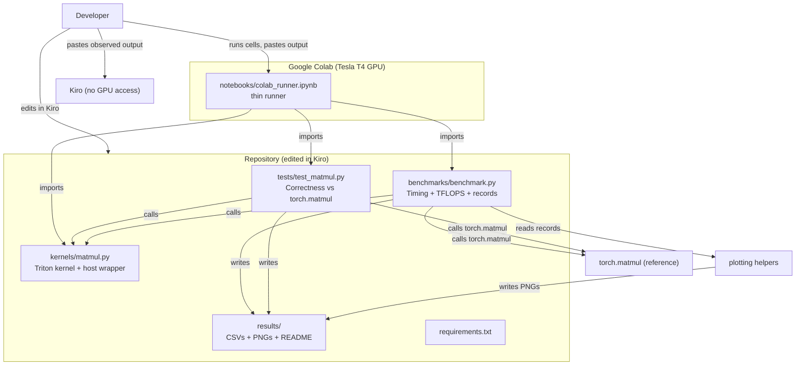
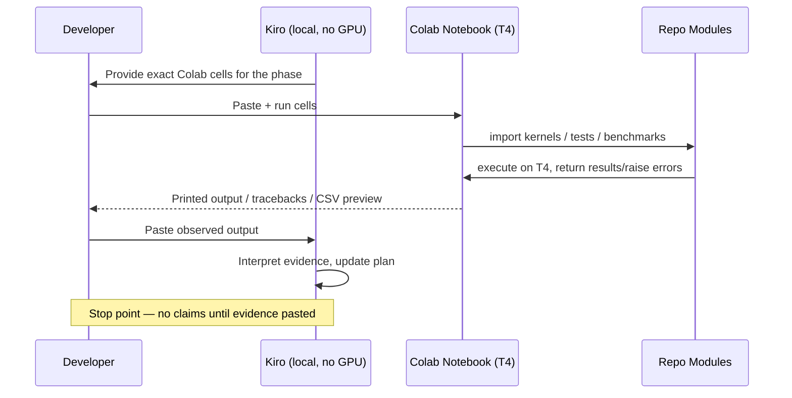
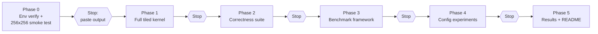
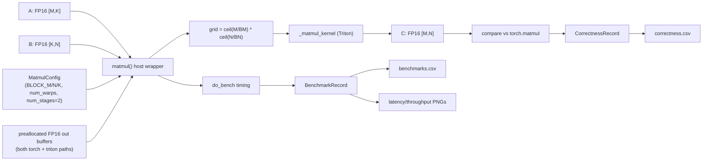

# Design Document: Triton GPU Kernel Optimization and Benchmarking

## Overview

This project is a learning-focused, reproducible GPU kernel engineering study that implements a tiled matrix-multiplication kernel in Triton, validates its numerical correctness against `torch.matmul`, benchmarks it against PyTorch on the same GPU, and runs manual configuration-level optimization experiments. The goal is to understand and experimentally evaluate the engineering principles used in deep-learning kernel libraries such as NVIDIA cuDNN and FlashInfer, grounded in observed evidence rather than assumption.

The project runs under a **split execution model**: the developer authors and edits all code in Kiro locally, but all GPU execution happens in Google Colab on an NVIDIA Tesla T4 (compute capability 7.5, Turing). Kiro **cannot** run GPU code or inspect Colab outputs. Every phase therefore ends at an explicit **stop point** where the developer runs supplied Colab cells and pastes back the observed output before the next phase proceeds. No claim about compilation success, correctness, benchmark numbers, or performance improvement is ever made without the developer pasting observed evidence.

The architecture keeps all logic in importable Python modules (`kernels/`, `benchmarks/`, `tests/`). The Colab notebook is a thin runner that clones/imports the repository and calls into those modules, so there is no duplicated kernel or benchmark code living in notebook cells. The environment is treated as fixed and confirmed working (PyTorch 2.11.0+cu130, CUDA 13.0, Triton 3.6.0); the design explicitly forbids downgrading or reinstalling these dependencies and forbids Ampere+ / BF16 / FP8 features that the Turing T4 does not support.

## Execution Environment and Hard Constraints

These constraints are first-class design inputs and are referenced throughout:

- **GPU:** NVIDIA Tesla T4, compute capability 7.5 (Turing).
- **Stack (confirmed working, do NOT change):** PyTorch 2.11.0+cu130, CUDA 13.0, Triton 3.6.0, `torch.cuda.is_available() == True`.
- **Confirmed baseline:** a simple Triton vector-add kernel has already compiled, executed, and passed numerical correctness in this environment. This confirms the toolchain is live, but it does **not** guarantee the matmul kernel (which uses `tl.dot`, larger tiles, and more shared memory) will compile. If the matmul kernel fails, diagnose the **actual** error before proposing any dependency change.
- **Numerics:** FP16 inputs, FP32 accumulation, FP16 outputs. No BF16, no FP8, no Ampere+ features.
- **No autotuning** in the main experiments; configs are passed explicitly (including a fixed `num_stages`).
- **Do NOT auto-downgrade, reinstall, or replace PyTorch or Triton.** Dependency changes are a last resort, not a default.
- **Kiro runs locally with NO NVIDIA GPU.** All GPU execution happens in Colab. Kiro does not claim to have run GPU code or obtained measurements unless the developer pastes actual Colab output.
- **Incremental, evidence-first:** start with a smoke test on supported tile dims; diagnose real failures before proposing any dependency change.

## Architecture

### Component Overview



### Module Boundaries

| Module | Responsibility | Runs GPU code? | Depends on |
|--------|----------------|----------------|------------|
| `kernels/matmul.py` | Triton `@triton.jit` tiled kernel + a host wrapper (`matmul`) that configures grid, dtypes, and launches. | Yes (in Colab) | `triton`, `torch` |
| `tests/test_matmul.py` | Build inputs with deterministic seeds, run kernel, compare to `torch.matmul`, compute error metrics, emit correctness records. | Yes (in Colab) | `kernels.matmul`, `torch` |
| `benchmarks/benchmark.py` | Steady-state timing via `triton.testing.do_bench`, TFLOPS, speedup, OOM/unsupported handling, record emission, plotting. | Yes (in Colab) | `kernels.matmul`, `torch`, `triton.testing`, `matplotlib`, `csv` |
| `notebooks/colab_runner.ipynb` | Thin orchestration: set up repo path, import modules, run smoke/tests/benchmarks, display results. | Yes (orchestrates) | all repo modules |
| `results/` | Output artifacts: `benchmarks.csv`, `correctness.csv`, PNGs, `README.md`. | No | — |

**Key boundary rule:** the notebook contains *no* kernel logic, *no* timing logic, and *no* correctness logic. It only imports and calls. This guarantees the same code paths run in Colab and would run anywhere else, and keeps the repository as the single source of truth.

### Colab Integration Model



The notebook gets the repository into Colab's import path via one of two documented options (chosen by the developer, both provided as cells):
1. `git clone` the repo, then `sys.path.append(repo_dir)`.
2. Upload the folder / mount Google Drive, then `sys.path.append(repo_dir)`.

A single cell verifies the environment (prints GPU name, compute capability, and PyTorch/CUDA/Triton versions) and must match the confirmed stack before any kernel runs.

### Phased Workflow and Stop Points



Each phase ends with a fixed closing report: **(1)** files created/modified, **(2)** implementation explanation, **(3)** exact Colab execution instructions, **(4)** what remains unverified, **(5)** an explicit stop to await pasted output before proceeding.

## Data Flow



## Components and Interfaces

### Component 1: Kernel Module (`kernels/matmul.py`)

**Purpose:** Implement the tiled Triton matmul and a thin host wrapper that validates shapes/dtypes, computes the launch grid, and launches the kernel. Supports square and rectangular inputs and dimensions not divisible by tile sizes (via masks).

**Public interface:**

```python
@dataclass(frozen=True)
class MatmulConfig:
    block_m: int = 64
    block_n: int = 64
    block_k: int = 32
    num_warps: int = 4
    num_stages: int = 2       # fixed at 2 for ALL experiments; recorded, not hidden

def matmul(a: "torch.Tensor",
           b: "torch.Tensor",
           config: MatmulConfig = MatmulConfig(),
           out: "torch.Tensor | None" = None) -> "torch.Tensor":
    """Compute C = A @ B with the custom Triton tiled kernel.

    A: FP16 [M, K], B: FP16 [K, N]. Returns C: FP16 [M, N]
    (FP32 accumulation internally). If `out` is provided it is used as
    the output buffer (preallocated-output benchmarking) and is validated
    for shape [M,N], FP16 dtype, same CUDA device as inputs, and a
    supported/contiguous memory layout. `config.num_stages` is passed
    explicitly to the kernel launch."""

@triton.jit
def _matmul_kernel(a_ptr, b_ptr, c_ptr,
                   M, N, K,
                   stride_am, stride_ak,
                   stride_bk, stride_bn,
                   stride_cm, stride_cn,
                   BLOCK_M: tl.constexpr,
                   BLOCK_N: tl.constexpr,
                   BLOCK_K: tl.constexpr):
    ...
```

**Responsibilities:**
- Validate: `a.dtype == b.dtype == float16`, `a.ndim == b.ndim == 2`, `a.shape[1] == b.shape[0]`, both on CUDA.
- Validate any supplied `out` tensor: expected shape `[M,N]`, FP16 dtype, same CUDA device as the inputs, and a supported/contiguous memory layout. Allocate an FP16 output `C[M,N]` only when `out` is not supplied.
- Compute a 1-D grid of `ceil(M/BLOCK_M) * ceil(N/BLOCK_N)` programs.
- Launch `_matmul_kernel` with strides, `num_warps`, and `num_stages` from config (both passed explicitly).
- The kernel does the tiled multiply with FP32 accumulation and FP16 store, with boundary masks on every load/store.

### Component 2: Correctness Module (`tests/test_matmul.py`)

**Purpose:** Validate the kernel against `torch.matmul` across a fixed matrix of shapes, with deterministic seeds and FP16-safe input ranges, producing per-case `CorrectnessRecord`s.

**Public interface:**

```python
def make_inputs(m: int, k: int, n: int, seed: int = 0
                ) -> "tuple[torch.Tensor, torch.Tensor]":
    """Deterministic FP16 inputs in an FP16-safe range."""

def ref_fp16(a, b) -> "torch.Tensor":
    """PRIMARY reference: torch.matmul(a, b) with FP16 inputs/output.
    Used for the pass/fail acceptance decision with the fixed tolerances."""

def ref_fp32(a, b) -> "torch.Tensor":
    """DIAGNOSTIC reference: torch.matmul(a.float(), b.float()) in FP32.
    Helps understand combined accumulation + FP16-output-rounding effects.
    This does NOT perfectly isolate every source of numerical error."""

def error_metrics(c_test, c_ref) -> "tuple[float, float]":
    """Return (max_abs_error, robust_rel_error). Both operands are
    converted to FP32 before the error is computed so the error
    calculation itself never uses FP16 arithmetic. The relative error
    avoids division by near-zero reference magnitudes."""

def run_correctness(cases: "list[ShapeCase] | None" = None,
                    config: MatmulConfig = MatmulConfig()
                    ) -> "list[CorrectnessRecord]":
    """Run all cases for EVERY config, compare to ref_fp16 (primary) and
    ref_fp32 (diagnostic), return records. Acceptance (elementwise):
    abs(c_triton - c_ref) <= atol + rtol*abs(c_ref) with fixed
    atol=1e-2, rtol=1e-2, evaluated in FP32. Does NOT loosen tolerances
    to force a pass; failed cases are preserved and investigated."""

DEFAULT_CASES: "list[ShapeCase]"  # includes required shapes below
```

**Required cases (`DEFAULT_CASES`):**
- `256×256×256`, `512×512×512`
- `M=1000, N=1500, K=700` (rectangular)
- at least one small non-square case (e.g. `M=64, N=128, K=96`)
- at least one non-multiple-of-tile case (e.g. `M=130, N=70, K=50` with default 64/64/32 tiles)

**Responsibilities:**
- Validate **every** tile/warp config against PyTorch before its benchmark results are accepted.
- Set `torch.manual_seed(seed)` per case for reproducibility.
- Keep input magnitudes in an FP16-safe band so reference and kernel agree within hardware precision.
- Apply the elementwise acceptance rule `abs(c_triton - c_ref) <= atol + rtol*abs(c_ref)` with **fixed** `atol=1e-2`, `rtol=1e-2`, performing the comparison in FP32 (convert outputs to FP32 first).
- Compute `max_abs_error` and a robust relative error against **both** `ref_fp16` (primary) and `ref_fp32` (diagnostic), and record all four metrics regardless of pass/fail.
- Classify each case `passed` / `failed` and keep the raw metrics regardless. On failure, preserve the observed errors and investigate the cause; never silently loosen tolerances or discard failed cases.

### Component 3: Benchmark Module (`benchmarks/benchmark.py`)

**Purpose:** Produce trustworthy steady-state timing for the custom kernel and `torch.matmul` on the same GPU, derive TFLOPS and speedup, handle OOM / unsupported configs gracefully, and emit records + plots.

**Public interface:**

```python
def tflops(m: int, n: int, k: int, latency_ms: float) -> float:
    """(2*M*N*K) / (latency_seconds * 1e12)."""

def bench_median(fn: "Callable[[], Any]") -> float:
    """PRIMARY latency in ms via triton.testing.do_bench(..., return_mode="median").
    Includes GPU warmup + synchronization; excludes one-time compilation."""

def bench_quantiles(fn: "Callable[[], Any]") -> "tuple[float, float, float]":
    """Additional latency quantiles (p20, p50, p80) in ms via a SEPARATE
    triton.testing.do_bench(..., quantiles=[0.2, 0.5, 0.8]) invocation.
    The quantile-run p50 is recorded independently and must NOT be assumed
    equal to the primary median above."""

def environment_info() -> "EnvInfo":
    """Collect GPU model, compute capability, PyTorch/CUDA/Triton versions."""

def run_benchmarks(sizes: "list[ShapeCase] | None" = None,
                   configs: "list[MatmulConfig] | None" = None,
                   preallocate_output: bool = True
                   ) -> "list[BenchmarkRecord]":
    """Benchmark the identical operation C = A @ B for custom kernel vs
    torch.matmul for each size/config, using preallocated FP16 output
    buffers on BOTH sides (torch.matmul(a,b,out=c_torch) and
    matmul(a,b,config,out=c_triton)). Attempts EVERY config; records
    skipped/failed cases with the ACTUAL error type and message."""

def write_csv(records, path) -> None: ...
def plot_latency(records, path) -> None: ...
def plot_throughput(records, path) -> None: ...
```

**Benchmark sizes:** `512³`, `1024³`, `2048³`, `4096³`, and `M=1000/N=1500/K=700`.

**Responsibilities:**
- Warm up and use synchronized, steady-state timing through `triton.testing.do_bench`. Use `do_bench(..., return_mode="median")` **explicitly** for the PRIMARY latency measurement.
- ALSO record latency quantiles at 0.2 / 0.5 / 0.8 via a separate `do_bench(..., quantiles=[0.2, 0.5, 0.8])` invocation. Do **not** assume the quantile-run p50 equals the primary median; document the methodology and distinguish the two.
- Exclude one-time Triton compilation from steady-state (do a throwaway launch before timing) and document this.
- Benchmark **one operation consistently** (`C = A @ B`) with **preallocated FP16 output buffers on both sides**: `torch.matmul(a, b, out=c_torch)` and `matmul(a, b, config, out=c_triton)`. Disclose any residual allocation differences.
- Compute `TFLOPS = (2*M*N*K) / (latency_seconds * 1e12)` and speedup from the actual measured latencies.
- Attempt **every** one of the six tile/warp configs — do not predetermine which work on the T4. Catch `triton.runtime.errors.OutOfResources`, compilation failures, and `torch.cuda.OutOfMemoryError` per case; record a `skipped` row carrying the **actual error type and message** in `skip_reason` (not a generic label), free memory (`torch.cuda.empty_cache()`), and continue.
- Treat unsupported configs and performance regressions as valid experimental findings, not failures to hide.
- Never label a run faster than PyTorch without the actual measured record.

### Component 4: Colab Runner (`notebooks/colab_runner.ipynb`)

**Purpose:** Thin orchestrator that imports repo modules and runs each phase; holds no reusable logic.

**Responsibilities (as ordered cells):**
1. Repo setup + `sys.path` wiring (clone or upload/mount options).
2. Environment verification cell (prints GPU + versions; must match confirmed stack).
3. Phase 0 smoke test cell (256×256).
4. Correctness cell → preview `correctness.csv`.
5. Benchmark cell → preview `benchmarks.csv`.
6. Plotting cell → display PNGs.
7. Results-persistence cell → download `results/` locally or commit/push to GitHub (Colab runtime is ephemeral).
Each cell is self-contained and prints enough for the developer to paste back as evidence.

## Data Models

### ShapeCase

```python
@dataclass(frozen=True)
class ShapeCase:
    m: int
    n: int
    k: int
    label: str          # e.g. "512^3", "rect_1000x1500x700"
    seed: int = 0
```

**Validation:** all dims `> 0`; `label` unique within a run.

### MatmulConfig

```python
@dataclass(frozen=True)
class MatmulConfig:
    block_m: int = 64
    block_n: int = 64
    block_k: int = 32
    num_warps: int = 4
    num_stages: int = 2       # FIXED at 2 for all experiments; recorded everywhere
```

**Validation:** block sizes are positive powers of two appropriate for `tl.dot`; `num_warps ∈ {4, 8}` for the experiment matrix; `num_stages == 2` for every experiment. **Every** config is attempted on the T4 — nothing is predetermined as supported or unsupported. A config that fails to compile or launch is recorded as skipped with its actual error type and message, never silently dropped. `num_stages` is recorded in config metadata, CSV results, and the README (not a hidden variable).

**Phase 4 experiment matrix** `(BLOCK_M, BLOCK_N, BLOCK_K, num_warps, num_stages)`:
`(64,64,32,4,2)`, `(64,64,32,8,2)`, `(128,128,32,4,2)`, `(128,128,32,8,2)`, `(128,64,32,4,2)`, `(128,64,32,8,2)`.

### CorrectnessRecord

```python
@dataclass
class CorrectnessRecord:
    label: str
    m: int
    n: int
    k: int
    block_m: int
    block_n: int
    block_k: int
    num_warps: int
    num_stages: int                 # fixed 2, recorded
    seed: int
    max_abs_error_fp16: float       # vs ref_fp16 (primary), computed in FP32
    rel_error_fp16: float           # robust relative error vs ref_fp16
    max_abs_error_fp32: float       # vs ref_fp32 (diagnostic)
    rel_error_fp32: float           # robust relative error vs ref_fp32
    atol: float                     # fixed 1e-2
    rtol: float                     # fixed 1e-2
    passed: bool                    # from the FP16 acceptance rule
    note: str                       # explanation of any discrepancy
```

### BenchmarkRecord

```python
@dataclass
class BenchmarkRecord:
    label: str
    m: int
    n: int
    k: int
    block_m: int
    block_n: int
    block_k: int
    num_warps: int
    num_stages: int                   # fixed 2, recorded
    impl: str                         # "triton_custom" | "torch"
    status: str                       # "ok" | "skipped"
    skip_reason: str                  # "" | actual error type + message
    latency_ms_primary_median: float  # do_bench(return_mode="median"); NaN if skipped
    latency_ms_p20: float             # from quantiles=[0.2,0.5,0.8] run; NaN if skipped
    latency_ms_p50: float             # quantile-run median (NOT the primary median)
    latency_ms_p80: float             # NaN if skipped
    tflops: float                     # from primary median; NaN if skipped
    speedup_vs_torch: float           # from measured latencies; NaN for torch/skipped
    max_abs_error_fp16: float         # from paired correctness check (vs ref_fp16)
    rel_error_fp16: float
    max_abs_error_fp32: float         # diagnostic (vs ref_fp32)
    rel_error_fp32: float
    gpu_model: str
    compute_capability: str
    torch_version: str
    cuda_version: str
    triton_version: str
```

### EnvInfo

```python
@dataclass(frozen=True)
class EnvInfo:
    gpu_model: str            # "Tesla T4"
    compute_capability: str   # "7.5"
    torch_version: str        # "2.11.0+cu130"
    cuda_version: str         # "13.0"
    triton_version: str       # "3.6.0"
    cuda_available: bool
```

### CSV Schemas

**`results/correctness.csv`:**
```
label,m,n,k,block_m,block_n,block_k,num_warps,num_stages,seed,max_abs_error_fp16,rel_error_fp16,max_abs_error_fp32,rel_error_fp32,atol,rtol,passed,note
```

**`results/benchmarks.csv`:**
```
label,m,n,k,block_m,block_n,block_k,num_warps,num_stages,impl,status,skip_reason,latency_ms_primary_median,latency_ms_p20,latency_ms_p50,latency_ms_p80,tflops,speedup_vs_torch,max_abs_error_fp16,rel_error_fp16,max_abs_error_fp32,rel_error_fp32,gpu_model,compute_capability,torch_version,cuda_version,triton_version
```

## Low-Level Design: Kernel Algorithm

### Grid mapping (host wrapper)

```python
def matmul(a, b, config=MatmulConfig(), out=None):
    assert a.dtype == torch.float16 and b.dtype == torch.float16
    assert a.ndim == 2 and b.ndim == 2 and a.shape[1] == b.shape[0]
    assert a.is_cuda and b.is_cuda
    M, K = a.shape
    _, N = b.shape

    if out is not None:
        # Validate a supplied preallocated output buffer.
        assert out.shape == (M, N), "out must have shape [M, N]"
        assert out.dtype == torch.float16, "out must be FP16"
        assert out.is_cuda and out.device == a.device, "out must be on same CUDA device"
        assert out.is_contiguous(), "out must use a supported/contiguous layout"
        c = out
    else:
        c = torch.empty((M, N), dtype=torch.float16, device=a.device)

    # 1-D grid: one program per (BLOCK_M x BLOCK_N) output tile.
    grid = (triton.cdiv(M, config.block_m) * triton.cdiv(N, config.block_n),)

    _matmul_kernel[grid](
        a, b, c,
        M, N, K,
        a.stride(0), a.stride(1),
        b.stride(0), b.stride(1),
        c.stride(0), c.stride(1),
        BLOCK_M=config.block_m,
        BLOCK_N=config.block_n,
        BLOCK_K=config.block_k,
        num_warps=config.num_warps,
        num_stages=config.num_stages,   # passed EXPLICITLY, fixed at 2
    )
    return c
```

### Kernel pseudocode (pointer arithmetic + masking + accumulator loop)

```python
@triton.jit
def _matmul_kernel(a_ptr, b_ptr, c_ptr,
                   M, N, K,
                   stride_am, stride_ak,
                   stride_bk, stride_bn,
                   stride_cm, stride_cn,
                   BLOCK_M: tl.constexpr,
                   BLOCK_N: tl.constexpr,
                   BLOCK_K: tl.constexpr):
    # ---- Tile assignment ----------------------------------------------
    # One program computes one BLOCK_M x BLOCK_N tile of C.
    # Linearize the 1-D program id into a 2-D tile coordinate (pid_m, pid_n).
    pid = tl.program_id(axis=0)
    num_pid_n = tl.cdiv(N, BLOCK_N)
    pid_m = pid // num_pid_n            # tile row index
    pid_n = pid % num_pid_n            # tile col index

    # ---- Row/column offsets for this tile ------------------------------
    offs_m = pid_m * BLOCK_M + tl.arange(0, BLOCK_M)   # [BLOCK_M] rows of C/A
    offs_n = pid_n * BLOCK_N + tl.arange(0, BLOCK_N)   # [BLOCK_N] cols of C/B
    offs_k = tl.arange(0, BLOCK_K)                     # [BLOCK_K] shared dim

    # ---- Base pointers for A and B tiles -------------------------------
    # A[offs_m, offs_k]: shape [BLOCK_M, BLOCK_K] via 2-D pointer arithmetic.
    a_ptrs = a_ptr + (offs_m[:, None] * stride_am + offs_k[None, :] * stride_ak)
    # B[offs_k, offs_n]: shape [BLOCK_K, BLOCK_N].
    b_ptrs = b_ptr + (offs_k[:, None] * stride_bk + offs_n[None, :] * stride_bn)

    # ---- FP32 accumulator ----------------------------------------------
    acc = tl.zeros((BLOCK_M, BLOCK_N), dtype=tl.float32)

    # ---- Accumulator loop over K in BLOCK_K steps ----------------------
    # Loop invariant: acc holds the partial sum of A[:, 0:k0] @ B[0:k0, :]
    # for the k0 columns/rows processed so far, in FP32.
    for k0 in range(0, K, BLOCK_K):
        k_remaining = K - k0
        # Mask columns of A / rows of B that fall past K (non-multiple-of-tile).
        a_mask = (offs_m[:, None] < M) & (offs_k[None, :] < k_remaining)
        b_mask = (offs_k[:, None] < k_remaining) & (offs_n[None, :] < N)

        a_tile = tl.load(a_ptrs, mask=a_mask, other=0.0)   # FP16, OOB -> 0
        b_tile = tl.load(b_ptrs, mask=b_mask, other=0.0)   # FP16, OOB -> 0

        # tl.dot multiplies FP16 tiles and accumulates into FP32.
        acc += tl.dot(a_tile, b_tile)

        # Advance pointers along K for the next K-tile.
        a_ptrs += BLOCK_K * stride_ak
        b_ptrs += BLOCK_K * stride_bk

    # ---- Cast FP32 accumulator to FP16 and store with boundary mask ----
    c = acc.to(tl.float16)
    c_ptrs = c_ptr + (offs_m[:, None] * stride_cm + offs_n[None, :] * stride_cn)
    c_mask = (offs_m[:, None] < M) & (offs_n[None, :] < N)
    tl.store(c_ptrs, c, mask=c_mask)
```

### Formal Specifications

**`_matmul_kernel`**
- **Preconditions:** `A` is FP16 `[M,K]`, `B` is FP16 `[K,N]`, both CUDA-resident; strides match a 2-D contiguous (or valid) layout; `BLOCK_M, BLOCK_N, BLOCK_K` are positive compile-time constants; `num_stages` is fixed at 2; grid size equals `cdiv(M,BLOCK_M) * cdiv(N,BLOCK_N)`.
- **Postconditions:** for every in-bounds `(i, j)` with `i < M, j < N`, `C[i,j]` **agrees with** `torch.matmul(A, B)[i,j]` within the documented tolerances `abs(C[i,j] - ref) <= atol + rtol*abs(ref)` (`atol=rtol=1e-2`). This is **not** a claim of bitwise/exact equality with an ideal FP32 accumulation rounded to FP16: accumulation order and floating-point rounding (both in `tl.dot`'s FP32 accumulation and in the final FP16 cast) produce differences within these tolerances. Out-of-bounds tile lanes are never written.
- **Loop invariant (K-loop):** after processing K-offset `k0`, `acc[i,j]` equals the FP32 running sum of the per-tile `tl.dot` partial products over `p < min(k0+BLOCK_K, K)` for in-bounds lanes (up to FP32 rounding and accumulation order); masked-out lanes contribute `0`.

**`matmul` (host wrapper)**
- **Preconditions:** `a.dtype == b.dtype == float16`, 2-D, `a.shape[1] == b.shape[0]`, both on CUDA; `config.num_stages` is passed through to the launch; if `out` given, it is FP16 `[M,N]`, contiguous, on the same CUDA device as the inputs.
- **Postconditions:** returns FP16 `[M,N]` equal to the kernel result; no mutation of `a` or `b`; `out` (if given) is the returned tensor.

**`error_metrics`**
- **Preconditions:** `c_test` and `c_ref` have identical shape.
- **Postconditions:** returns `(max_abs_error, rel_error)` computed in FP32 (both operands cast to FP32 first, so no FP16 arithmetic enters the error calculation) where
  `max_abs_error = max |c_test - c_ref|` and
  `rel_error = max( |c_test - c_ref| / max(|c_ref|, eps) )` over all elements, with `eps` chosen to avoid division by near-zero reference values (robust relative error). No input mutation.

### Kernel Explanation and Conceptual Hand Trace (teaching aid)

After the first working kernel compiles, `kernels/matmul.py` is explained step by step through meaningful inline comments covering: Triton **program IDs** and how the grid maps to output tiles, the **pointer arithmetic** for A/B/C tiles, the **memory access patterns**, the **boundary masks** on loads/stores, the **FP32 accumulator initialization**, the **K-dimension accumulation loop**, and the final **FP16 output conversion**.

The following is a **conceptual** hand trace used purely for teaching. It is **not** a 2×2 `tl.dot` kernel to compile (the actual GPU smoke test uses supported tile dims such as `64×64×32`). It illustrates the index/pointer/mask reasoning on a tiny `M=4, N=4, K=4` problem with a `2×2` output tile (`BLOCK_M=BLOCK_N=BLOCK_K=2`):

- **Grid.** `num_pid_m = cdiv(4,2) = 2`, `num_pid_n = cdiv(4,2) = 2`, so the 1-D grid has `2*2 = 4` programs, `pid ∈ {0,1,2,3}`.
- **Grid-to-tile mapping** (row-major, `pid_m = pid // num_pid_n`, `pid_n = pid % num_pid_n`):
  - `pid=0 → (pid_m=0, pid_n=0)` → output tile C[0:2, 0:2] (rows 0–1, cols 0–1)
  - `pid=1 → (0, 1)` → C[0:2, 2:4] (rows 0–1, cols 2–3)
  - `pid=2 → (1, 0)` → C[2:4, 0:2] (rows 2–3, cols 0–1)
  - `pid=3 → (1, 1)` → C[2:4, 2:4] (rows 2–3, cols 2–3)
- **Addresses read (take `pid=0`).** `offs_m=[0,1]`, `offs_n=[0,1]`. For K-tile `k0`, it reads `A[[0,1], k0:k0+2]` and `B[k0:k0+2, [0,1]]` via `a_ptr + offs_m[:,None]*stride_am + offs_k[None,:]*stride_ak` and the analogous `b_ptrs`.
- **K-loop accumulation.** `K=4`, `BLOCK_K=2`, so two iterations: `k0=0` and `k0=2`.
  - `k0=0`: `acc += tl.dot(A[[0,1],0:2], B[0:2,[0,1]])` — partial sum over p=0,1.
  - `k0=2`: `acc += tl.dot(A[[0,1],2:4], B[2:4,[0,1]])` — partial sum over p=2,3.
  - After both, `acc[i,j] = Σ_{p=0..3} A[i,p]*B[p,j]` in FP32, then cast to FP16 on store.
- **Masks prevent OOB.** For this exact divisible case masks are all-true, but if instead `M=3` (not a multiple of `BLOCK_M=2`), program `pid_m=1` covers rows `{2,3}` while row 3 is out of range; the mask `offs_m[:,None] < M` is `[True, False]`, so lane for row 3 loads `0.0` and is never stored. The same reasoning applies to `offs_n < N` and `offs_k < k_remaining` along K.

## Example Usage

```python
# Phase 0 smoke test (in Colab, via import) — uses SUPPORTED tile dims (64x64x32)
from kernels.matmul import matmul, MatmulConfig
import torch

a = torch.randn((256, 256), dtype=torch.float16, device="cuda")
b = torch.randn((256, 256), dtype=torch.float16, device="cuda")
c_triton = torch.empty((256, 256), dtype=torch.float16, device="cuda")
matmul(a, b, MatmulConfig(64, 64, 32, 4, num_stages=2), out=c_triton)
c_ref = torch.matmul(a, b)                                   # ref_fp16 (primary)
print(c_triton.shape, c_triton.dtype)                        # torch.Size([256, 256]) torch.float16
print((c_triton.float() - c_ref.float()).abs().max().item()) # observe actual error in FP32

# Correctness (Phase 2) — every config validated vs ref_fp16 (atol=rtol=1e-2)
from tests.test_matmul import run_correctness
for rec in run_correctness():
    print(rec.label, rec.passed, rec.max_abs_error_fp16, rec.max_abs_error_fp32)

# Benchmark (Phase 3/4) — preallocated FP16 out on both sides
from benchmarks.benchmark import run_benchmarks, write_csv
records = run_benchmarks()
write_csv(records, "results/benchmarks.csv")
```

## Correctness Properties

### Property 1: Reference agreement
**Validates: Requirements 2.1, 2.2**

For every shape case **and every tile/warp config**, with inputs in the FP16-safe range, `∀ (i,j)` the kernel output satisfies the elementwise rule `abs(c_triton - ref_fp16) <= atol + rtol*abs(ref_fp16)` with fixed `atol=rtol=1e-2`, evaluated in FP32. Tolerances are fixed in advance and never loosened to force a pass; a failing case is preserved, investigated, and reported with an explanation.

### Property 2: Shape generality
**Validates: Requirements 1.1, 1.2**

`∀` square, rectangular, small non-square, and non-multiple-of-tile shapes, the kernel returns a correct `[M,N]` FP16 result (masks guarantee no out-of-bounds read/write).

### Property 3: Accumulation precision
**Validates: Requirements 1.3, 2.3**

`∀` tested magnitudes, accumulation is performed in FP32 and only the final tile is cast to FP16; the max absolute error (measured in FP32) stays consistent with the documented tolerances. The FP32 diagnostic reference (`ref_fp32`) is recorded alongside the FP16 primary reference to help understand combined accumulation + FP16-output-rounding effects, without claiming to isolate every source of error.

### Property 4: Determinism
**Validates: Requirements 2.4**

`∀` cases, re-running with the same seed and config yields byte-identical inputs and metrics within run-to-run GPU nondeterminism bounds.

### Property 5: TFLOPS definition
**Validates: Requirements 3.1, 3.2**

`∀` benchmark rows, `tflops == (2*m*n*k) / (latency_ms_primary_median/1000 * 1e12)`, where `latency_ms_primary_median` is the `do_bench(return_mode="median")` figure (distinct from the quantile-run `latency_ms_p50`).

### Property 6: Evidence integrity
**Validates: Requirements 6.1, 6.2**

`∀` records, none is marked `ok`/`passed` and no speedup is reported unless produced by an actual observed run; skipped cases carry a non-empty `skip_reason` holding the actual error type and message.

### Property 7: Operation consistency
**Validates: Requirements 3.3**

`∀` benchmarked sizes, both `impl` rows benchmark the identical operation `C = A @ B` with preallocated FP16 output buffers on both sides (`torch.matmul(a,b,out=c_torch)` and `matmul(a,b,config,out=c_triton)`); any residual allocation difference is disclosed in the methodology.

## Error Handling

### GPU Out-of-Memory (large benchmark sizes, e.g. 4096³)
- **Condition:** `torch.cuda.OutOfMemoryError` during allocation or launch.
- **Response:** record a `skipped` `BenchmarkRecord` with `skip_reason` carrying the actual `OutOfMemoryError` type and message, call `torch.cuda.empty_cache()`, continue to the next case.
- **Recovery:** benchmark run completes with partial results; OOM cases are visible in the CSV.

### Config compile/launch/resource failure on T4
- **Condition:** `triton.runtime.errors.OutOfResources`, a Triton compilation failure, or any launch error while attempting a config. Every one of the six configs is attempted; none is predetermined as unsupported.
- **Response:** record `skipped` with `skip_reason` carrying the **actual error type and message** (not a generic label).
- **Recovery:** continue to the next config; unsupported configs are valid experimental findings, visible in the CSV.

### Correctness failure
- **Condition:** the fixed-tolerance rule `abs(c_triton - ref_fp16) <= atol + rtol*abs(ref_fp16)` (`atol=rtol=1e-2`, evaluated in FP32) is violated.
- **Response:** `passed=False`, keep raw FP16 and FP32 error metrics, write a `note` explaining the likely cause (e.g. accumulation ordering, magnitude), and investigate. Do **not** silently loosen tolerances or discard the failed case.
- **Recovery:** benchmarks for that config are not accepted until the correctness result is understood/passing.

### Environment mismatch
- **Condition:** verification cell shows versions/GPU differing from the confirmed stack.
- **Response:** stop and surface the mismatch to the developer; do not attempt automatic reinstall/downgrade of PyTorch or Triton.
- **Recovery:** developer decides; design default is to keep the confirmed stack.

### Kiro-cannot-observe constraint
- **Condition:** any point where GPU evidence is needed.
- **Response:** emit a stop point with exact Colab cells and the five-part closing report; make no success/performance claims.
- **Recovery:** proceed only after the developer pastes observed output.

## Testing Strategy

### Unit / Correctness Testing
- `tests/test_matmul.py` drives the required shape matrix with deterministic seeds and FP16-safe inputs, comparing to `torch.matmul` and recording `max_abs_error` + robust `rel_error`.
- Correctness is run and understood **before** any benchmark result is accepted (ties to P1/P6).

### Correctness-Property Baseline
- The Correctness Properties above (P1–P7) are the PBT-style specification for this project. They are exercised directly through the **required explicit shape cases** (`256³`, `512³`, `1000×1500×700`, a small non-square case, and a non-multiple-of-tile case) run against both `ref_fp16` (primary) and `ref_fp32` (diagnostic) for every tile/warp config. These explicit cases are the correctness baseline; no external property-generation library is used.

### Benchmark "Testing" (methodology validation)
- Sanity checks that latency is positive, TFLOPS matches the P5 formula against the primary median, and that each benchmarked size/config has a paired FP16 error metric from a correctness check before its numbers are trusted.

## Performance Considerations
- Timing uses `triton.testing.do_bench` with warmup and device synchronization. The **primary** figure is `do_bench(return_mode="median")`; latency quantiles at 0.2/0.5/0.8 are recorded additionally from a separate `quantiles=[0.2,0.5,0.8]` invocation. The quantile-run p50 is reported independently and is **not** assumed equal to the primary median.
- One-time Triton compilation is excluded from steady-state via a throwaway launch before timing; this is documented in the README methodology.
- `num_stages` is fixed at 2 across all experiments; Phase 4 investigates tile-size and `num_warps` effects on throughput/latency and identifies the fastest **correct** config per workload. Comparison is always: initial Triton implementation vs. best measured Triton config vs. PyTorch — reported only from measured records. Performance regressions are reported as valid findings, and no speedup is invented or assumed.

## Security Considerations
Not security-sensitive. The only operational caution: do not auto-run environment-mutating installs; keep the confirmed PyTorch/Triton stack. Treat any pasted Colab output as developer-provided data to interpret, not as instructions to execute blindly.

## Dependencies
Kept minimal and aligned with the confirmed, pre-installed Colab stack (`requirements.txt` documents versions but installs nothing extra on Colab where they already exist):
- `torch==2.11.0+cu130` (preinstalled on the T4 Colab — do not reinstall)
- `triton==3.6.0` (preinstalled — do not reinstall)
- `matplotlib` (plots; only install if missing)
- Standard library: `csv`, `dataclasses`, `statistics`.

## Results Persistence (outside Colab's temporary runtime)

Colab's runtime filesystem is ephemeral, so generated artifacts must be saved off-runtime. The notebook provides an explicit final step with both options; the developer picks one:

1. **Download locally** — e.g. `from google.colab import files; files.download("results/benchmarks.csv")` for each CSV/PNG.
2. **Save/commit to the GitHub repo** — stage `results/` and push from a cell (or download and commit from Kiro locally).

Kiro does **not** auto-commit fabricated, empty, or unverified results; only artifacts produced by an actual observed Colab run are persisted.

## Documentation and Attribution (README)

The `results/README.md` (and top-level `README.md`) must:

- **Acknowledge** that the kernel structure was informed by Triton's official matmul tutorial, and **document the differences** from it:
  - plain row-major 1-D program ordering instead of the tutorial's grouped (super-grouping) ordering;
  - manual config experiments instead of Triton `autotune`;
  - no fused activation/epilogue;
  - a custom correctness harness (two references, fixed tolerances, FP32-evaluated errors) and a custom benchmark harness;
  - a Tesla T4-specific environment (CC 7.5, FP16 in / FP32 accumulate / FP16 out).
- **Explain performance results from actual observations**, clearly separating measurements, interpretations, and hypotheses, and reporting the fixed `num_stages=2` as a documented experimental variable.
- Compare the initial Triton implementation vs. the best measured Triton config vs. PyTorch without inventing speedups or assuming Triton outperforms PyTorch.

## Repository Structure
```
kernels/matmul.py             # Triton kernel + MatmulConfig + matmul() host wrapper
benchmarks/benchmark.py       # timing, TFLOPS, records, OOM/skip handling, plots
tests/test_matmul.py          # correctness suite + error metrics + records
notebooks/colab_runner.ipynb  # thin runner: imports modules, runs phases
results/                      # benchmarks.csv, correctness.csv, *.png, README.md
requirements.txt              # documented versions (minimal installs)
README.md                     # objective, theory, env, methodology, results, repro
```
The notebook imports these modules rather than embedding logic, so the same code runs in Colab without duplication (ties to the architecture's key boundary rule).
```
